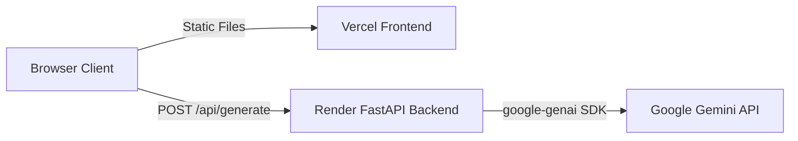

# MindForge

> **Shape the way you learn.**

MindForge is an intelligent study workspace that transforms unstructured lecture notes and reading materials into structured learning guides, interactive retrieval quizzes, and active-recall flashcards. Powered by Google Gemini, MindForge helps learners engage in active learning with real-time feedback and privacy-first local analytics.

- 🔗 **Live Application:** [https://mind-forge-frontend-tau.vercel.app](https://mind-forge-frontend-tau.vercel.app)
- 📁 **GitHub Repository:** [https://github.com/shabi-2-2/MindForge](https://github.com/shabi-2-2/MindForge)

---

## Overview

Traditional studying often relies on passive rereading, leading to low retention and information overload. MindForge solves this by turning raw study notes into active learning workflows.

Users input a topic and their notes, select their preferred answer style and difficulty, and generate a tailored study pack. The backend orchestrates prompt synthesis, structured generation, and response validation via Google Gemini, while the frontend provides interactive review tools with zero account friction.

---

## Key Features

- 📝 **AI-Generated Summaries**: Concise, structured summaries highlighting key academic concepts.
- 🎯 **Interactive Retrieval Quizzes**: Five-question scored multiple-choice quizzes with instant grading and explanatory rationales.
- 🗂️ **Active-Recall Flashcards**: 3D flip study cards with mastery tagging (Known / Not known) and progress indicators.
- ⚙️ **Customizable Styles & Difficulty**: Adapt study materials to exam, plain, kid, or academic tones across three difficulty tiers.
- 📚 **Local History & Saved Sessions**: Automatic browser saving, search, filtering, and session reloading.
- 📊 **Learning Analytics**: Streak tracking, study minute estimates, mastery rates, and 14-day activity charts.
- 🌓 **Theme Customization**: Fluid light and dark modes respecting system preferences.
- ♿ **Accessible & Responsive**: Keyboard-navigable, screen-reader friendly (ARIA live regions), responsive off-canvas drawer, and reduced-motion support.

---

## Screenshots

<!-- Place actual UI screenshots in assets/screenshots/ and link them below -->
<!--  -->
<!--  -->

*(UI preview available directly on the [Live Demo](https://mind-forge-frontend-tau.vercel.app))*

---

## Tech Stack

- **Frontend**: Vanilla HTML5, Vanilla CSS, Vanilla JavaScript (ES6+, No framework, zero build step)
- **Backend**: Python 3.11+, FastAPI, Pydantic v2, Uvicorn
- **AI Engine**: Google Gemini API (`gemini-3.6-flash` via `google-genai` SDK)
- **Storage**: Browser `localStorage` (Local-first, privacy-focused persistence)
- **Hosting & CI/CD**: Vercel (Static Frontend) & Render (FastAPI Web Service)

---

## Architecture

MindForge decouples client-side presentation from server-side AI processing to maintain performance and prevent API credential exposure:



> **Security Note**: The `GEMINI_API_KEY` remains strictly on the Render backend environment. The client never accesses or stores AI credentials.

---

## Live Deployments

- **Frontend Application**: [https://mind-forge-frontend-tau.vercel.app](https://mind-forge-frontend-tau.vercel.app)
- **Backend Health Check**: [https://mindforge-api-85fh.onrender.com/api/health](https://mindforge-api-85fh.onrender.com/api/health)
- **Interactive API Documentation**: [https://mindforge-api-85fh.onrender.com/docs](https://mindforge-api-85fh.onrender.com/docs)

---

## Local Setup

### Prerequisites
- Python 3.11+
- Modern Web Browser
- Gemini API Key from [Google AI Studio](https://aistudio.google.com/apikey)

### 1. Backend Setup
```bash
# Clone the repository
git clone https://github.com/shabi-2-2/MindForge.git
cd MindForge/backend

# Create and activate virtual environment
python3 -m venv .venv
source .venv/bin/activate

# Install dependencies
pip install -r requirements.txt

# Configure environment variables
cp .env.example .env
# Edit .env and supply your GEMINI_API_KEY and GEMINI_MODEL=gemini-3.6-flash

# Start FastAPI backend
uvicorn app.main:app --reload --host 127.0.0.1 --port 8000
```

### 2. Frontend Setup
In a new terminal window from the repository root:
```bash
# Serve static frontend
python3 -m http.server 5500
```
Open [http://localhost:5500](http://localhost:5500) in your browser.

> For production deployment instructions to Vercel and Render, see [DEPLOYMENT.md](DEPLOYMENT.md).

---

## Project Structure

```
MindForge/
├── assets/              # Icons, favicons, and graphic assets
├── backend/
│   ├── app/             # FastAPI routers, models, config, and services
│   ├── tests/           # Pytest test suite
│   ├── requirements.txt # Python dependencies
│   └── .env.example     # Backend environment template
├── css/                 # Vanilla stylesheets (styles.css, responsive.css)
├── js/                  # Vanilla JavaScript modules (UI, storage, contract)
├── tests/               # Node.js frontend test suite
├── index.html           # Single-page application entry point
├── render.yaml          # Render Blueprint deployment specification
├── vercel.json          # Vercel static hosting and security headers
└── DEPLOYMENT.md        # Comprehensive deployment manual
```

---

## Testing

Both frontend and backend include automated regression and validation test suites:

- **Frontend Tests** (Validation, storage migration, UI accessibility):
  ```bash
  node --test tests/*.test.mjs
  ```
- **Backend Tests** (Contract enforcement, CORS, Gemini error handling):
  ```bash
  cd backend && python -m pytest tests -q
  ```

---

## Security

- **Zero Client Credential Leakage**: Secrets are never delivered to the client, committed to Git, or injected into static builds.
- **Production HTTPS Guard**: In production environments, client code rejects non-HTTPS and loopback endpoints.
- **Strict CORS Protection**: Backend only permits requests from explicit allowed origins with credentials disabled.
- **Sanitized Error Handling**: Exceptions are caught server-side and mapped to safe user messages without exposing internal stack traces or raw AI responses.

---

## License

No license has been specified for this project.
